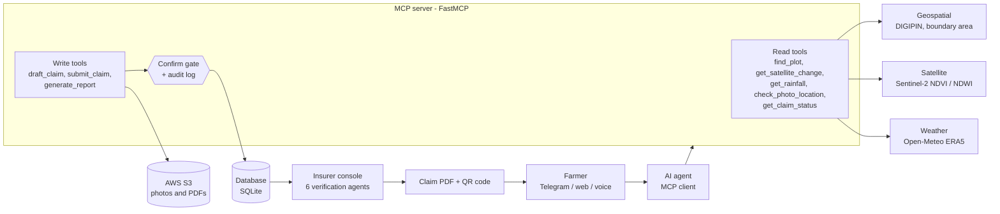
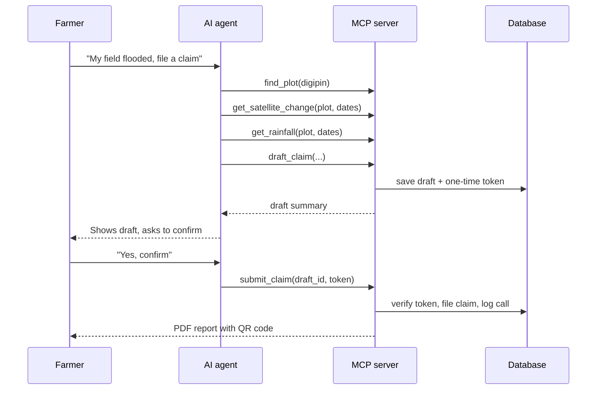

# KisanClaim MCP

**An MCP-powered agent that helps a farmer file a crop-damage insurance claim from a simple chat message, backed by satellite and rainfall evidence, with the farmer always in control.**

wHACKiest 2026 · Track 01: Make MCP Matter · Team: Error 404 : Idea found

> **Status: blueprint.** This repository holds the plan, architecture and specifications for the 24-hour build on 1-2 December 2026. Implementation starts on hack day.

---

## 1. Problem

After a flood or drought, a farmer must report the damage quickly and prove it. Under crop insurance schemes such as PMFBY, this still means forms, field surveys and weeks of waiting.

- Millions of smallholder farmers are insured, but many struggle with English or Hindi forms and online portals.
- Insurers cannot easily tell genuine claims from fake ones, because photos are easy to fake and field visits are slow.
- Existing portals and apps depend on manual forms and visits, with no plot-level satellite proof and no chat or voice filing.

## 2. Solution

A farmer sends one message, by chat or voice, in Kannada or English. An AI agent uses **MCP tools** to:

1. find the farmer's plot (DIGIPIN and drawn boundary),
2. collect satellite vegetation change and rainfall evidence,
3. check that photo evidence was taken inside the plot,
4. draft the claim and show it to the farmer,
5. file the claim **only after the farmer confirms**,
6. return a PDF report with a QR code, while insurers review the claim in a console with verification agents.

**What makes it "MCP that matters":** it works where people already are (a chat app), connects the tools they need, and every action that changes something is controlled, confirmed and logged.

## 3. Architecture



**Process flow:** Input (farmer message) → Processing (tools gather evidence) → Confirm (farmer approves draft) → Output (claim filed and PDF report).

### Claim sequence



## 4. MCP tool specification

| Tool | Type | Purpose | Main inputs | Output |
|---|---|---|---|---|
| `find_plot` | Read | Locate a plot by DIGIPIN or coordinates | `digipin` or `lat, lon` | plot id, boundary, area |
| `get_satellite_change` | Read | Vegetation and water change from Sentinel-2 | `plot_id, before_date, after_date` | NDVI before/after, NDWI, % change |
| `get_rainfall` | Read | Rainfall and soil moisture for the event | `plot_id, start, end` | daily rainfall, anomaly flag |
| `check_photo_location` | Read | Is a geotagged photo inside the plot area? | `plot_id, lat, lon` | distance in metres, pass or fail |
| `get_claim_status` | Read | Current status of a claim | `claim_id` | status, decision |
| `draft_claim` | Write | Prepare a claim, change nothing yet | plot, crop, disaster type, loss declared | draft id + one-time token + summary |
| `submit_claim` | Write, **gated** | File the claim after farmer approval | `draft_id, token` | claim id |
| `generate_report` | Write | Build the PDF dossier with QR code | `claim_id` | PDF link |

## 5. Controls ("controlled and reliable")

- **Confirm gate:** `submit_claim` rejects any call without a valid one-time token, and the token is issued only after the farmer says yes.
- **Read vs write separation:** read tools run freely, write tools are limited and checked.
- **Audit log:** every tool call is stored with time, inputs and result.
- **Grounded answers:** numbers shown to the farmer come only from tool results, never invented.
- **Indicative scores:** satellite and rainfall evidence supports the decision; a human insurer adjudicates.

## 6. Data model (SQLite)

| Table | Main fields |
|---|---|
| `farmers` | id, name, phone, language |
| `plots` | id, farmer_id, digipin, boundary points, area |
| `claim_drafts` | id, plot_id, crop, disaster type, loss declared, token, expires_at |
| `claims` | id, draft_id, status, estimated payout, pdf_url, decision |
| `evidence` | id, claim_id, type (satellite, rainfall, photo), values, file_url |
| `tool_audit_log` | id, tool, inputs, result, time |

## 7. Tech stack

| Layer | Technology | Why |
|---|---|---|
| Frontend | React, TypeScript, Vite, Tailwind, Leaflet | farmer dashboard, insurer console, map plot marking |
| Backend | Python, FastAPI, OpenCV, Pillow | geospatial, report and QR modules in one service |
| MCP layer | Python MCP SDK (FastMCP) | standard, typed tools for any AI agent |
| AI and voice | LLM agent as MCP client, ElevenLabs | natural-language filing; Kannada and English voice |
| Data sources | Sentinel-2 L2A, Open-Meteo ERA5, DIGIPIN | free, open data for plot-level proof |
| Storage | SQLite, AWS S3 | claims, tokens and audit trail; photos and PDFs |
| Chat | Telegram bot | an everyday app farmers already use |

**Sponsor use:** ElevenLabs (voice replies) and AWS (S3 storage).

## 8. 24-hour build plan

| Hours | Goal |
|---|---|
| 0-2 | Repo setup, database schema, MCP server skeleton |
| 2-6 | Read tools: plots, satellite change, rainfall, photo location |
| 6-10 | Draft, confirm gate, submit, audit log |
| 10-14 | Telegram bot and AI agent connected to the MCP server |
| 14-17 | ElevenLabs voice replies in Kannada and English |
| 17-20 | PDF report with QR code, insurer console view |
| 20-22 | Real data check, error handling, demo data |
| 22-24 | Demo rehearsal and README polish |

## 9. Impact and measures

- Farmers file in minutes, in their own language.
- Insurers verify with evidence instead of guesswork.
- We will measure: time to file a claim, share of claims corroborated by satellite and rainfall data, and fraud flags raised.
- Scales to any crop or state with Sentinel-2 and DIGIPIN coverage.

## 10. Risks and fixes

| Risk | Plan |
|---|---|
| Cloud cover hides the field in satellite images | use rainfall data and geotagged photos as backup |
| Estimates can be wrong | show as indicative; human adjudication decides |
| Agent misuse or mistakes | confirm gate, scoped tools, audit log |
| API rate limits | cache results |

## 11. Business model

- **Customers:** insurers and PMFBY implementing agencies, banks and cooperatives, farmer producer organisations. Farmers are free users.
- **Revenue:** per-claim verification fee or subscription for insurers, plus API access for agri-fintech partners.
- **Go-to-market:** pilot in one district with a cooperative or FPO and an insurer, reaching farmers through chat.

## 12. Planned repository layout

```
kisanclaim-mcp/
├── mcp_server/        # FastMCP server, tools, confirm gate, audit log
├── backend/           # FastAPI service, geospatial and report modules
├── bot/               # Telegram bot and agent client
├── frontend/          # farmer dashboard and insurer console
├── docs/              # diagrams and notes
└── README.md
```
