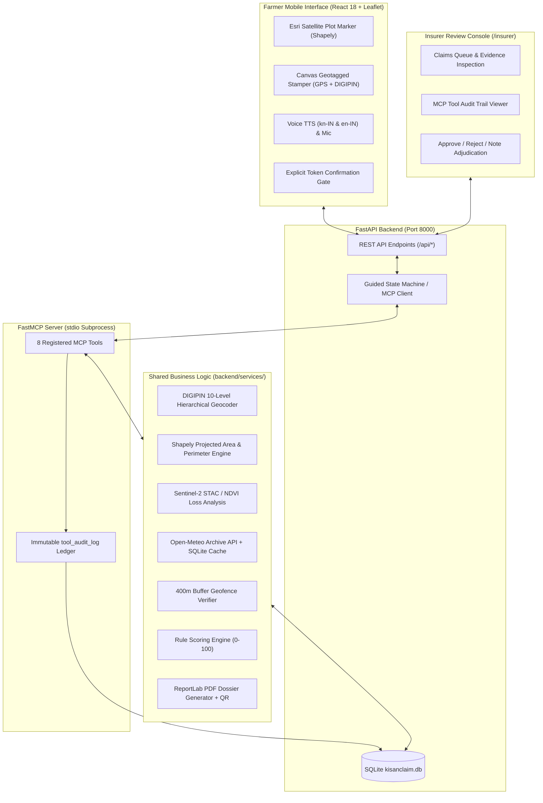

# 🌾 KisanClaim MCP

> **wHACKiest 2026 — Track 1: "Make MCP Matter"**  
> An autonomous, farmer-friendly crop insurance claim adjudication system that uses the **Model Context Protocol (MCP)** to gather real satellite and rainfall evidence, verify geotagged field photos, and enforce a strict human confirmation gate before filing.

---

## 🌟 What It Is
When floods, droughts, or storms ravage crops in rural India, smallholder farmers often struggle through weeks of bureaucratic paper delays under PMFBY (Pradhan Mantri Fasal Bima Yojana). 

**KisanClaim MCP** bridges the divide:
- A rural farmer marks their 4-corner field boundaries on high-resolution satellite imagery or simply speaks to the AI assistant in **Kannada (ಕನ್ನಡ)** or **English**.
- The AI assistant invokes **real MCP tools over stdio** to query Sentinel-2 satellite vegetation drop (NDVI) and Open-Meteo precipitation records.
- Farmers capture geotagged field photos stamped with **India Post's 10-character DIGIPIN**, GPS coordinates, and timestamp.
- **The Core Security Gate**: The assistant drafts the claim and issues a single-use token; the claim is **strictly barred from submission until the farmer inspects the summary and clicks "Yes, file my claim"**.
- An instant, rule-based verification score (0–100) and downloadable official ReportLab PDF dossier are generated with a QR code linking to the live claim status.

---

## 📸 Screenshot-Style Feature List

| Feature | Visual Description |
| :--- | :--- |
| **📱 Farmer-First Mobile UI** | Earthy high-contrast palette (`#2E7D32` forest green, `#F9A825` warm amber, `#FFF8E1` cream). Big 56px touch targets, step progress indicator, and plain language. |
| **🌐 Bilingual (EN / ಕನ್ನಡ)** | One-click toggle between English and Kannada on every screen. All UI labels and assistant messages fully translated. |
| **🔊 Regional Voice Accessibility** | In-browser `speechSynthesis` (`kn-IN` and `en-IN`) with "Listen" buttons on every key screen, plus voice mic button (`webkitSpeechRecognition`) for conversational claim filing. |
| **🗺️ Plot Marking & Live Shapely Math** | Leaflet satellite map (Esri World Imagery). Farmers tap 4 corners and drag pins to adjust. Live area (acres) and perimeter (m) calculated via Shapely projection. |
| **📮 DIGIPIN Geo-Addressing** | Encodes the plot center into India Post's 10-level hierarchical grid (`XXX-XXX-XXXX`), enabling surveyors to pinpoint rural plots without ambiguous land titles. |
| **🛰️ Satellite NDVI Crop Loss** | Sentinel-2 STAC API query with fallback. Compares pre- and post-disaster NDVI with percentage drop and interactive before/after visual cards. Always clearly badged as *Live satellite data* or *Sample data (demo)*. |
| **🌧️ Rainfall Anomaly Engine** | Open-Meteo precipitation archive API with SQLite caching. Automatically flags flash flood spikes (≥ 50 mm/day or ≥ 100 mm window) and severe drought deficits (< 10 mm). |
| **📷 Geotagged Camera Canvas** | In-browser camera (`getUserMedia`, back camera preferred) with canvas watermark overlaying GPS, DIGIPIN, farmer name, and timestamp. Verifies coordinates against a 400 m plot perimeter buffer. |
| **🔒 Gated One-Time Token** | MCP tool `draft_claim()` issues a 30-minute confirmation token. MCP tool `submit_claim()` strictly refuses to execute without this valid, unconsumed token. |
| **📄 ReportLab PDF Dossier** | Generates a complete claim dossier PDF featuring farmer details, DIGIPIN, NDVI before/after table, rainfall breakdown, stamped field photo, rule score reasons, indicative payout, and status QR code. |
| **🛡️ Insurer Adjudication Portal** | Separate `/insurer` console for surveyors to review evidence, inspect audit trails, and approve or reject claims with recorded notes. |

---

## 🏗️ Architecture Diagram



---

## 🛠️ The 8 MCP Tools

In `mcp_server/server.py`, 8 typed tools are exposed over stdio via the official Python MCP SDK (`FastMCP`). Every tool call writes an immutable entry into `tool_audit_log`:

| Tool Name | Type | Description |
| :--- | :--- | :--- |
| `find_plot(farmer_id)` | Read | Retrieves farmer's registered plot: polygon, area (acres), perimeter, DIGIPIN, and survey number. |
| `get_satellite_change(plot_id, before_date, after_date)` | Read | Returns Sentinel-2 NDVI before/after values, percentage change, and source flag (`LIVE` or `SAMPLE`). |
| `get_rainfall(plot_id, start_date, end_date, disaster_type)` | Read | Fetches daily rainfall from Open-Meteo, calculates window total, max daily spike, and evaluates disaster anomalies. |
| `check_photo_location(plot_id, lat, lon)` | Read | Calculates distance in meters from plot boundary and returns whether photo is within 400 m buffer (`passed: true/false`). |
| `get_claim_status(claim_id)` | Read | Retrieves current adjudication status, insurer notes, score, and PDF path. |
| `draft_claim(plot_id, crop, disaster_type, disaster_date, loss_percent)` | Write | Saves claim draft and issues a 30-minute confirmation token. **Does not submit anything.** |
| `submit_claim(draft_id, token)` | Write, **Gated** | **Security Gate**: Verifies token exists, is unused, and is unexpired (< 30 min). Executes rule score, marks token used, and submits claim. **Strictly rejects without valid token.** |
| `generate_report(claim_id)` | Write | Builds comprehensive ReportLab PDF dossier with QR code and returns file path and download URL. |

---

## 🚀 How to Run in Under 5 Steps

### Prerequisites
- Python 3.11+
- Node.js 18+ (tested on Node v20)

### 1. Clone & Enter Project
```bash
git clone <repo-url>
cd kisanclaim-mcp
```

### 2. Copy Environment File
```bash
cp .env.example .env
# Windows Command Prompt:
# copy .env.example .env
```

### 3. Run the Launcher Script
```bash
# On Linux / macOS:
chmod +x start.sh
./start.sh

# On Windows:
start.bat
```

The script automatically sets up the Python virtual environment, installs backend and frontend packages, seeds the database, and launches:
- **Farmer Web App**: `http://localhost:5173`
- **Insurer Review Console**: `http://localhost:5173` *(Click "Insurer Console" button in header)*
- **Backend API & Swagger Docs**: `http://localhost:8000/docs`

### 4. Run Pytest Suite
```bash
# Windows
venv\Scripts\python -m pytest backend/tests

# Linux/macOS
venv/bin/pytest backend/tests
```
*All 16 tests pass: DIGIPIN round-trip, Shapely area, geofence buffer, rule scoring, and token gate verification.*

---

## 🎬 Demo Script (3-Minute Walkthrough)

Follow these exact clicks for an end-to-end demo:

1. **Login (15 sec)**:
   - Open `http://localhost:5173` in a mobile-sized browser window.
   - Click the big amber button: **"Instant Login as Demo Farmer (Ravi Kumar)"**.
   - Notice the greeting banner showing registered plot area (6.81 Acres) and DIGIPIN `4PC-MK3-J434`.
   - Click the language toggle (`ಕನ್ನಡ` / `English`) in the top-right header to show instant translation.
   - Click the speaker button to hear the Kannada voice read the greeting aloud.

2. **File a Claim Workflow (60 sec)**:
   - Click the big green button: **"File a New Claim"**.
   - **Step 1 (Plot)**: The Leaflet satellite map appears with Devanahalli coordinates. Drag pin #1 slightly. Notice live area (acres) and perimeter recalculating in real-time. Click **"Save Plot & Compute DIGIPIN"**.
   - **Step 2 (Evidence)**: The app calls `get_satellite_change` and `get_rainfall`. Notice the visible **"Sample data (demo)"** or **"Live satellite data"** badge, the NDVI comparison (-47.2%), and the Open-Meteo rainfall spike chart. Click **"Proceed to Field Photo"**.
   - **Step 3 (Camera)**: The camera screen activates with live GPS. Click **"Capture Photo"** (or upload). Notice the digital canvas watermark stamped across the bottom (`GPS`, `DIGIPIN`, `Farmer Name`, `Date/Time`). The geofence checker displays: *"Photo is inside your field (PASSED)"*. Click **"Attach Photo to Claim"**.
   - **Step 4 (Confirm Gate)**: Notice the one-time confirmation token displayed (`TOK-XXXX`). The indicative payout shows **₹15,000.00** with the disclaimer. Click the big green button: **"Yes, File My Claim"**.

3. **Instant Verification & PDF (30 sec)**:
   - **Step 5 (Done)**: The verification score card renders **85/100** with rule reasons.
   - Click **"Download Official PDF Dossier"**. A new tab opens with the ReportLab PDF complete with the farmer's details, NDVI table, rainfall bars, geotagged photo, and scan-ready QR code.

4. **Insurer Adjudication & Audit Log (45 sec)**:
   - In the header, click **"Insurer Console"**.
   - The claims dashboard lists all claims with statuses and scores. Click **"Review"** on the newly submitted claim.
   - Inspect the evidence and the **immutable SQLite MCP Tool Execution Audit Trail** showing every tool call (`find_plot`, `get_satellite_change`, `get_rainfall`, `check_photo_location`, `draft_claim`, `submit_claim`, `generate_report`).
   - Type a note *"Field verified by surveyor"* and click **"Approve Claim"**.
   - Switch back to the Farmer view; the claim now displays a green **"Approved"** status chip.

---

## ⚠️ Honest List of Limitations

1. **DIGIPIN Implementation**:  
   > [!IMPORTANT]  
   > *Verify against India Post's official DIGIPIN specification before real production use.* Our implementation uses a 10-level hierarchical $4 \times 4$ bounding box grid ($2.5^\circ$ to $38.5^\circ$ N, $63.5^\circ$ to $99.5^\circ$ E) achieving $\approx 4\text{ m}$ precision, which round-trips accurately in our test suite.

2. **Satellite Live vs. Sample Fallback**:  
   Sentinel-2 L2A STAC APIs may suffer from cloud obscuration, latency (> 20s), or rate limits. When `DEMO_MODE=true` or when cloud cover exceeds 35%, the service falls back to deterministic sample NDVI. **Sample data is always clearly labelled with a visible badge.**

3. **No Real SMS OTP**:  
   To allow rapid, reliable offline evaluation during hackathon judging, farmer login uses phone number and name without a third-party SMS gateway.

4. **Indicative Payout Disclaimer**:  
   > [!NOTE]  
   > *All calculated payouts (e.g. $\text{acres} \times \text{Scale of Finance} \times \text{loss}\%$) are indicative algorithmic estimates, not official PMFBY disbursements.* Final claim sanctions under PMFBY require insurer underwriter signoff.

---

## 📜 License
Built with ❤️ for wHACKiest 2026. Open source under the MIT License.
