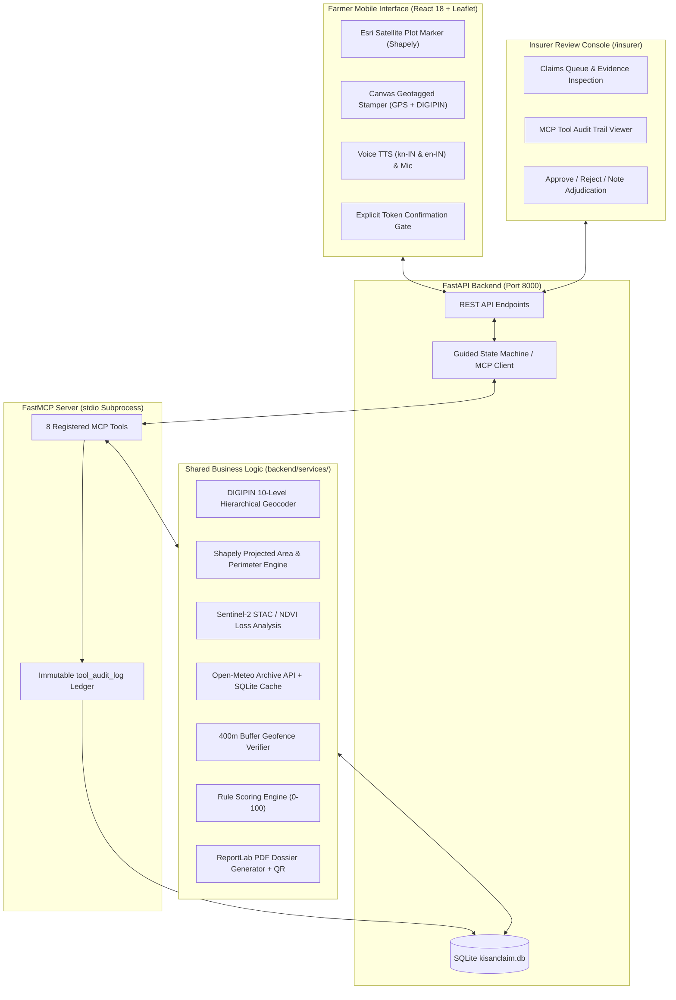

# KisanClaim MCP Architecture Documentation

## Overview
**KisanClaim MCP** is an autonomous crop insurance claim adjudication system designed for rural farmers in India. Built for **wHACKiest 2026 (Track 1: "Make MCP Matter")**, it implements the Model Context Protocol (MCP) to turn raw satellite data, weather station records, and geotagged field photos into legally defensible insurance claim dossiers.

## Security Gate Architecture
The Model Context Protocol specification separates tool invocation from unilateral execution. In KisanClaim MCP:
1. `draft_claim()` creates a preliminary record and generates a cryptographically random one-time confirmation token (`TOK-XXXX`) valid for 30 minutes.
2. `submit_claim(draft_id, token)` strictly enforces token validation:
   - Token must exist in `claim_tokens`.
   - Token must match `draft_id`.
   - Token must not have `used = 1`.
   - Current time must not exceed `expires_at`.
3. If valid, the token is marked used (`used = 1`), verification scoring is executed, and the claim status transitions to `SUBMITTED`.
4. It is impossible for an autonomous AI or attacker to file a claim without the farmer's explicit consent.
